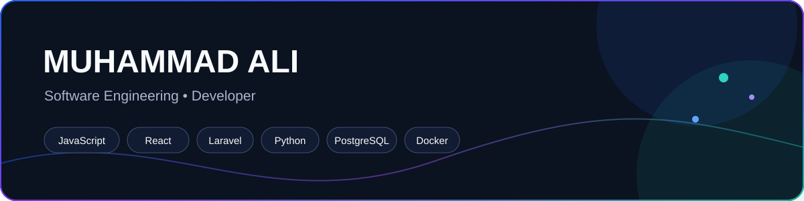
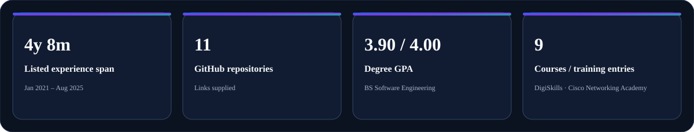

  
  
  

## About Me

Software developer with experience as a Junior Developer and Software Intern. I am pursuing a BS in Software Engineering at Virtual University of Pakistan, with a listed GPA of **3.90 / 4.00**.

## Experience

| Role | Organization | Dates |
|---|---|---|
| Software Intern | ANALOG.PK | June 2025 – August 2025 |
| Junior Developer | DUO SOLS | January 2021 – May 2025 |

## Career Timeline

## What I've Worked On / Projects

The following repositories are part of my GitHub work:

| Repository | Link |
|---|---|
| [downloader](https://github.com/muhammadaliajaz/downloader) | [View repository](https://github.com/muhammadaliajaz/downloader) |
| [converter](https://github.com/muhammadaliajaz/converter) | [View repository](https://github.com/muhammadaliajaz/converter) |
| [realchat](https://github.com/muhammadaliajaz/realchat) | [View repository](https://github.com/muhammadaliajaz/realchat) |
| [school-management-system](https://github.com/muhammadaliajaz/school-management-system) | [View repository](https://github.com/muhammadaliajaz/school-management-system) |
| [scanner](https://github.com/muhammadaliajaz/scanner) | [View repository](https://github.com/muhammadaliajaz/scanner) |
| [resume](https://github.com/muhammadaliajaz/resume) | [View repository](https://github.com/muhammadaliajaz/resume) |
| [Extractor](https://github.com/muhammadaliajaz/Extractor) | [View repository](https://github.com/muhammadaliajaz/Extractor) |
| [manufac-sols](https://github.com/muhammadaliajaz/manufac-sols) | [View repository](https://github.com/muhammadaliajaz/manufac-sols) |
| [store](https://github.com/muhammadaliajaz/store) | [View repository](https://github.com/muhammadaliajaz/store) |
| [RMS](https://github.com/muhammadaliajaz/RMS) | [View repository](https://github.com/muhammadaliajaz/RMS) |
| [SMS](https://github.com/muhammadaliajaz/SMS) | [View repository](https://github.com/muhammadaliajaz/SMS) |

## Tech Stack

**Backend**

**Frontend**

**Cloud & DevOps**

**Databases**

**Tools**

## Education & Certifications

**BS in Software Engineering**  
Virtual University of Pakistan  
October 2022 – September 2026  
GPA: **3.90 / 4.00**

**Artificial Intelligence Using Python — Training Completion**  
DigiSkills Training Program, DSTP 3.0 – Batch 03  
April 2026 – July 2026

**CPA: Programming Essentials in C++ — Statement of Achievement**  
Cisco Networking Academy  
8 July 2023

The Cisco course covered programming fundamentals, C++ syntax and semantics, basic data types, object-oriented programming concepts, developer tools, standard libraries, and writing C++ programs. The statement indicates readiness to attempt the CPA – C++ Certified Associate Programmer qualification; it is not presented here as that separate certification.

## GitHub Stats

## Let's Connect

- **LinkedIn:** [https://linkedin.com/in/muhammad-ali-8b00583bb](https://linkedin.com/in/muhammad-ali-8b00583bb)
- **GitHub:** [https://github.com/muhammadaliajaz](https://github.com/muhammadaliajaz)
- **Email:** [m.ali.ajaz.72@gmail.com](mailto:m.ali.ajaz.72@gmail.com)

*Thanks for visiting my profile!*

